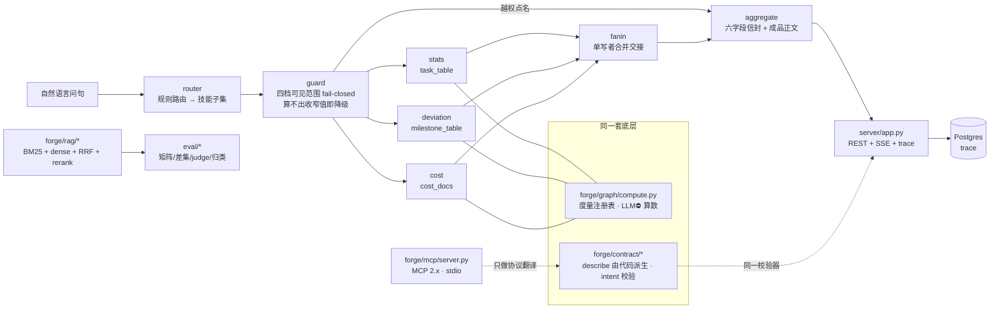

# Agent Runtime Forge

把一套**生产环境里跑过企业智能体的运行时框架**，用主流栈（Python + LangGraph + FastAPI + MCP + RAG + 评测流水线）重新实现一遍，做一次**有数据的对照**而不是偏好之争。

> ⚠️ 本项目使用**合成数据**。领域对象、指标公式与阈值取自一段真实的非标自动化装备行业项目管理系统经验，已全部脱敏：公司写作 `Acme Equipment Co.`，字段/表名均为通用命名，⛔ 不含任何真实企业数据、内部域名、应用 ID 或客户信息。

## 为什么要做这个对照

原实现运行在一个受限运行时里：平台只提供一个技能包 zip 和一条命令行，沙箱**不允许安装第三方依赖**，因此契约层、编排层、取数计算层、评测层只能用零依赖 Node.js 自己写。这个项目把它搬到 LangGraph 等现成框架上，回答两个问题：

1. 现成框架替你承担了哪一层（状态通道、checkpoint、HITL 中断、并行 fan-in）；
2. 它又替你把哪一层变成了黑盒（可观测粒度、评测口径、权限判定位置）。

## 架构



**三条编排线跑同一个业务问题**（这是本仓库的核心实验，不是冗余）：

| 线 | 循环在谁手里 | 模型轮次 | 落点 |
|---|---|---|---|
| Line A 官方 `create_agent` + 中间件 | 框架 | 2 | `forge/graph/react_agent.py` |
| Line A2 手写最小 ReAct 环 | 框架（回头边是我画的） | 2 | `forge/graph/react_min.py` |
| Line B 公司范式（无环 + 批次并行） | 宿主 | **0** | `forge/graph/plan_graph.py` |

⇒ 三条线 **10 条指标逐字一致**（`tests/test_graph_parity.py`），差别只在**轮次与上下文成本**。

## 四层职责表（含"⛔ 归谁"，这半列才是重点）

| 层 | 我做什么 | ⛔ 不归我（⛔ 别揽） |
|---|---|---|
| 工具契约 | `describe()` 代码派生、`intent` 字典校验、非法枚举回带合法值、越界钳位 | 平台侧的技能加载与沙箱 |
| 依赖调度 | 静态依赖图 → 拓扑计划、批次并行、失败隔离不当 0 计入 | **循环本身**（宿主驱动那段归宿主会话） |
| 取数口径 | 确定性公式、度量注册表、无数据≠0、`as_of` 显式注入 | 模型侧的措辞与句式 |
| 评测与发布门禁 | 矩阵枚举、回归差集、judge 分段、失败归类、能失败变异 | 业务方对口径的最终裁定（我给证据⛔ 替他们决定） |

## 指标总表（⛔ 手写：每个数都由 `tools/d7_metrics_sync.py` 与 `eval/` 报告比对后写入）

| 指标 | 值 | 出处 |
|---|---|---|
| 测试 | **191 passed** | `uv run pytest` |
| 能失败变异 | **40/40**（D1 5+D2 6+D3 5+D4 6+D5 6+D6 6） | `uv run python tools/mutation_check.py` |
| 并行竞态压测 | 同 thread 20 次 + 20 thread 并发 ⇒ **0 次字段覆盖** | `tests/test_graph_channels_race.py` |
| 覆盖率矩阵 | **80 格**（10 域 × 8 问法）· 命中率 1.0（⚠️ 结构性偏高，见 caveat） | `eval/report.md` |
| RAG 质量（语义档） | top1 引用正确率 **0.5443 → 0.6055**（bm25→dense）；Recall@5 0.7156→0.7554 | `eval/rag_report_semantic.md` |
| Reranker | Recall@5 **0.7798（最高）** 但 top1 **0.5352（更低）** ⇒ 双向结果 | 同上 |
| 随机基线 | top1 0.0345（1/29）· Recall@5 0.1724（5/29） | 同上（头条取 top1） |
| QA 评估集 | **327 条**（定义 112 / 流程 63 / 异常处理 152） | `eval/qa_set.jsonl` |
| 服务延迟 | compose+Postgres **P50 60.9 / P95 77.9 / P99 104.4 ms**；本机 P95 73.7 ms | `eval/latency.md` |
| 冷启动 | 首批 P95 ≈ **638.5 ms**（单独留档，⛔ 混进热态） | 同上 |
| MCP 真协议往返 | **9/9**（含枚举随 schema 下发、非法值拒答带合法值） | `uv run python tools/d5_mcp_smoke.py` |
| 容器验收 | **5/5**（REST/SSE/Postgres trace/降级/后端自报） | `uv run python tools/d6_compose_smoke.py` |

## 三个取舍（为什么这样做，⛔ 为什么那样做）

**① 为什么用图式并行而⛔ 一路串行？**
批次并行把首问时延压下来，但真代价在**共享可变状态**：三条分支共写同一份交接文件时，
实测后写者会**把整份文档换掉**且⛔ 任何异常（这就是当年"数据对、来源标签漂"的成因）。
⇒ 解法⛔ 是加锁：各分支写独立 state 通道、只有 fan-in 单点写、合并语义用 reducer 显式声明。
LangGraph 对"返回同一个 channel key"会抛 `InvalidUpdateError`，但对"共写外部文件/原地改共享对象"
⛔ 管——**框架能抓住的只是通道冲突，⛔ 是共享可变状态**。

**② 为什么 LLM⛔ 算数？**
生产真机上模型把 53% 写成 71%、关键路径自报 3 个（真值 7）。⇒ 所有业务算术进代码，
派生量带 `numerator/denominator/as_of`，答案里的每个数字都能反查；模型只逐字转述成品正文。
副作用是新增指标必须注册（加一行注册 + 一条考卷），但这正是"能失败"的落点：
D4 的规则评分里有 `fabricated-number` 专抓凭空数字。

**③ 为什么自研契约层而⛔ 直接用现成工具注册？**
不是"框架能力不行"：在能起常驻进程的环境里 LangGraph 完全够用。是**环境**——
平台只给 zip + 命令行、技能是一次性 CLI、脚本禁异步 ⇒ ⛔ 常驻进程可挂框架。
而且 MCP 只声明 schema，**⛔ 定义非法参数怎么办**：本项目实测两面确有差异——
MCP 面把未知参数**静默忽略**，自研 `--intent` 面会 `DROPPED:` 点名并继续执行。
（⛔ 说"我们实现了 MCP 协议"；说"解决同一类问题，但当时只有命令行"。）

## 边界：我⛔ 做什么（主动交底，⛔ 等对方挖）

1. 受限平台那条线**没有**任意循环（ReAct）、**没有**跨调用 checkpoint 恢复（只有会话级缓存）、
   **没有**流式 —— 这是**分工**（循环归宿主），⛔ 能力缺陷；这三样我在个人项目里真做过。
2. Reranker 实测**没提升 top1**（0.5352 < dense 0.6055），当前默认关；
   评测语料与 QA 集是**自建合成**，⛔ 生产问答质量。
3. 延迟数字是**单机、无鉴权、无网络跳数**（本机或单机 compose），⛔ 集群容量结论。
4. 结构化问数（要确定性数字）**⛔ 走向量召回**；RAG 只服务规则库/模板库问答——
   理由见「为什么结构化问数⛔ 走向量召回」。
5. 状态词：仓库尚未推公网 ⇒ 本项目当前是**开发中**，
   「已开源 / 附 Demo」要等 D7 发布真正做完。

## 当前状态（按天推进，每天有验收判据）

| 阶段 | 内容 | 状态 |
|---|---|---|
| D1 | 领域模型 + 确定性合成数据 + "能失败"的测试骨架 | ✅ 完成（2026-11-16） |
| D2 | LangGraph 图式编排，含真实竞态的解法 + checkpointer + interrupt | ✅ 完成（2026-11-18） |
| D3 | 工具契约层等价实现 + MCP Server | ✅ 契约层完成（2026-11-22）；MCP 封装按任务书属 D5，⛔ 提前做 |
| D4 | 评估流水线（规则评分 / LLM-as-Judge / 回归差集 / 覆盖率矩阵 / PR 前检查） | ✅ 完成（2026-11-22），80 格矩阵 + 86 条语料 + 28/28 变异 |
| D5 | RAG 检索线（本地 BGE 混合检索 + Reranker + 300 条业务 QA 评估集） | ✅ 完成（2026-11-23）：327 条 QA、**语义档 BGE + faiss + jieba 实跑**、MCP 真协议往返 9/9，两份报告并存（hash / semantic） |
| D6 | FastAPI + SSE 服务化与可观测 | ✅ 完成（2026-11-23）：容器端到端已验证，compose 热态 **P95 77.9 ms**（`eval/latency.md`） |
| D7 | 架构图、指标表、讲解稿 | ⏳ 未开始 |

⛔ **本 README 不承诺未经实测的能力**：`docker compose` 一键运行在 D6 之前不存在，届时若未在真实 Docker 环境验证过，也会在此明确标注"未验证"。

## D1 的设计决定（不是随便选的）

- **金额一律用整数分（cents），比率阈值用基点（bps）**。⛔ 不用 float 存钱——浮点表示会让"同一 seed 两次生成逐字节相同"这条验收变成运气。
- **所有日期敏感计算显式接收 `as_of`**，⛔ 禁止读系统时钟。真实项目里踩过：日期敏感指标跨天跑差集必然不等，差额恰好等于"没有实际结束日"的那批行数。
- **故意保留数据稀疏性**：`payment_plan` 只有 8% 的节点带计划金额、ECN 成本字段 90% 为 0、交付物每项目 10 项里只交付 0–3 项、750 用户只有 18 条权限配置。这些不是为了"数据难看"，它们正是逼出正确设计的原因（金额必须以计划表为主源；默认放行策略必须显式定义）。测试里**把比例钉死**，防止后来者为了好看把它填满。
- **"无数据"与 0 是两种状态**：公式在分母为 0／数据缺失时返回 `None`，⛔ 返回 0。真实系统的产物里，0 会被业务方读成"确实没花钱"。
- **不提供"实际工期"字段**：真实数据中实际开工日=实际完工日（完成时回填），任何基于"实际工期"的指标都是假的，所以口径直接否决，模型层就不给这个字段。

## 跑起来

```bash
uv sync                                                  # 装依赖（Python 3.11+）
uv run python -m forge.synth.generate --seed 42          # 生成合成数据到 data/
uv run pytest -q                                         # 全部测试
uv run python tools/mutation_check.py                    # 证明测试"能失败"（11 条）
uv run python tools/d2_api_probe.py                      # 框架语义实测读数（⛔ 凭记忆）

# D2 三条编排线跑同一个问句
uv run python -m forge.cli "PRJ-1180 的进度、里程碑偏差和成本怎么样" --line plan
uv run python -m forge.cli "PRJ-1180 进度" --line agent            # 离线打桩模型
uv run python -m forge.cli "PRJ-1180 进度" --line agent --live --model qwen3.8-flash   # 真模型（要 .env 里的 key）
uv run python -m forge.cli "PRJ-1180 进度" --line min              # 手写最小 ReAct 环
uv run python -m forge.cli "帮我给 bu-beta 立项" --line plan       # 停在人工闸上
uv run python -m forge.cli "帮我给 bu-beta 立项" --line plan --approve
# 契约层自查（D3）：菜单自吐 / 意图校验 / 三道门禁
uv run python -m forge.cli --describe stats                       # 说明书由代码派生
uv run python -m forge.cli --intent '{"metric":"conplte_rate","topK":999}'   # ⇒ BAD_INTENT + 钳位 + 回带枚举（退出码 2）
uv run python -m forge.cli --gates                                # G1/G2/G3，任一失败 exit 1

# 跨进程断点续办（真进程、硬杀）
uv run python tools/intake_host.py --scratch .tmp/demo --thread t1 --crash-in-verify 1.5
uv run python tools/intake_host.py --scratch .tmp/demo --thread t1 --continue
```

## D1 验收读数（2026-11-16，真实输出）

| 判据 | 结果 |
|---|---|
| 同一 seed 两次生成逐字节相同 | `sha256 = f8939fd913cd663c91e5d563d076edc6f381fd14efc5ba05cd76f06713b660b8`，两次运行完全一致 |
| seed 真的起作用 | `--seed 7` → 字节数 5,374,777（≠ 42 的 5,374,743），行数同为 24,949 ⇒ **内容变、形状不变** |
| 规模符合 §3.5 | project 300（BU 180/90/10/10 + 未填 10）、task 12,000（阶段 1,200 / 里程碑 600 / 工序 2,400 / 任务 7,800）、payment_plan 2,300 且**恰好 184 条带计划金额（8.00%）**、ECN 120 且**恰好 108 条成本为 0（90%）**、报工 615 条**只有 9 条有值**、合同 94 份**只有 3 份关联项目**、交付物每项目 10 项已交付 0–3、用户 750 / 权限配置 18 |
| 逾期形状精确 | 逾期未开工 **1,400** 条、延期进行中 **60** 条（同余计数保证，不是抽样近似） |
| 测试 | `38 passed in 4.61s`（Python 3.11.15 / pydantic 2.14.3 / pytest 9.2.0） |
| **能失败** | 5 项变异全部 **改歪→红 (rc=1)、改回→绿 (rc=0)**：逾期率分母、超期占比夹紧、预算为 0 判空、EAC 的 AC=0 判空、payment_plan 填充率填满 |

> 数字怎么来的别信我：`uv run pytest -q` 与 `uv run python tools/mutation_check.py` 各跑一次即可复现上表。

---

# D2 · LangGraph 编排复现与那起并行竞态

## D2 的三条编排线

同一个业务问题（"某项目的进度 / 里程碑偏差 / 成本怎么样"）跑三遍，**只有编排方式不同**：

| 线 | 文件 | 是什么 | 循环在谁手里 | 模型轮次 |
|---|---|---|---|---|
| A | `forge/graph/react_agent.py` | **业界主流入口** `create_agent` + 中间件 | 框架 | 2 |
| A2 | `forge/graph/react_min.py` | **手写最小 ReAct 环**（`model ⇄ tools` 一条回头边） | 框架（但边是我画的） | 2 |
| B | `forge/graph/plan_graph.py` | **公司范式重画**：`router → guard → 三分支并行 → fanin → aggregate` | 宿主（一趟出计划，⛔ 问模型） | 0 |

## D2 的主流分层对照（也是"框架替你承担了什么"的答案表）

| 关注点 | 主流做法 | 本仓库落点 | 原实现（零依赖 Node）对应物 |
|---|---|---|---|
| 骨架 | `create_agent` + middleware；必须确定的段落才手写成显式节点 | Line A / A2 | 静态无环依赖图 + 拓扑计划 |
| 技能身份证 | `@tool(args_schema=Pydantic)`，描述由代码/docstring 派生 | `forge/graph/tools.py` | `--describe` 代码派生自描述 |
| 工具面 | 按路由 **裁剪 bind_tools 子集**（⛔ 一次绑全部） | `router.route()` → `tools_for()` | 只吐技能菜单 |
| 并行与合并 | **channel + reducer**（`Annotated[..., operator.add]`） | `forge/graph/state.py` | 共写一份交接文件 ⇒ 事故 |
| 跨轮恢复 | checkpointer（本地 SQLite / 生产 Postgres），⛔ 业务大对象进 state | `forge/graph/checkpoint.py`，Dataset 按 seed 重载 | 仅会话缓存，**无跨调用恢复** |
| 人在环 | `interrupt` + `Command(resume=…)`，**approve / edit / reject** | Line A 用 HITL 中间件；Line B 自画 `confirm` 节点 | 只有设计口径，未落地 |
| 治理扩展 | 中间件（`ModelCallLimitMiddleware` 等），⛔ 改模型节点本体 | `react_agent.build_react_agent` | 受限并发池 `CONCURRENCY=4` |
| 取数 | 工具内调确定性计算层，⛔ 让模型算数 | `forge/graph/compute.py`（复用 D1 `formulas`） | 度量注册表 |
| 输出 | 结构化信封 + 成品正文 | `forge/graph/contract.py` | 信封 `{ok,code,message,digest[],notes[],answer}` |

## D2 框架语义实测（⛔ 凭记忆写 API，全部来自 `tools/d2_api_probe.py` / `d2_probe2.py` / `d2_probe3.py`）

| 实测问题 | 真实读数 |
|---|---|
| 装到的是什么版本 | langgraph 1.2.22 / langgraph-checkpoint-sqlite 3.1.3 / langchain 1.5.0 / langchain-core 1.8.1 / Python 3.11.15 |
| `create_react_agent` 还在 `langgraph.prebuilt` 吗 | 主流入口已迁到 **`langchain.agents.create_agent`**；中间件在 `langchain.agents.middleware`（HITL / ModelCallLimit / Summarization / before_model… 均可导入） |
| **两个并行节点返回同一个 channel key** | 🔊 抛 `InvalidUpdateError: At key 'handoff': Can receive only one value per step` ⇒ **框架把静默覆盖升级成显式报错**（原实现没有这层保护） |
| 两个并行节点**原地改 state 里同一个 dict** | 🤫 静默覆盖，无任何报错 |
| 两个并行节点**读-改-写同一份交接文件** | 🤫 静默覆盖，而且比预想更狠：**后写者把整份文档换掉**（连 `branches` 列表都只剩一路） |
| 同一 key 声明了 reducer | ✅ 合法且正确合并 ⇒ "报错"不是目的，**让合并语义显式化**才是 |
| `interrupt()` 怎么读 | `state["__interrupt__"] -> [Interrupt(value=…, id=…, response_schema=…)]`，恢复用 `Command(resume=…)` |
| HITL 中间件的载荷形状 | `interrupt_on={tool: {"allowed_decisions": […]}}`；决定是 `{"type": "approve" \| "edit"(+`edited_action`) \| "reject"(+`message`) \| "respond"}`，包在 `{"decisions": […]}` 里 |
| `SqliteSaver` 能异步吗 | ⛔ `aget_tuple` 直接 `NotImplementedError` ⇒ 并发/服务化必须换 `AsyncSqliteSaver`（依赖 `aiosqlite`，已加入） |
| `@tool(args_schema=TypedDict)` | ⛔ `TypeError: args_schema must be a subclass of pydantic BaseModel or a JSON schema dict` |
| `BaseChatModel.bind_tools` 基类实现 | 字面就是一行 `raise NotImplementedError` ⇒ 打桩模型必须自己实现，实现后 **`create_agent` 可完全离线跑**（全套测试零网络、零成本） |
| 崩在节点中间后重启的语义 | 已完成节点⛔ 重跑，**该节点从头重跑**（实测 `collect=1, verify=2`）⇒ 节点必须幂等 |
| 重启时再传一次新输入 | ⚠️ **那不是续跑**，是从 `START` 开新一轮，已完成的节点会重跑（真续跑只能 `invoke(None, cfg)`） |

## 那起竞态在这里的三种形状

```
事故形状  分支A 读文件 → 改 from/step ─┐
          分支B 读文件 → 改 from/step ─┴→ 后写覆盖先写：数据对、来源标签漂（静默）
框架保护  两节点 return 同一个 key      → InvalidUpdateError（响亮，原实现没有）
修复形状  各写各的 state 通道 + notes 用 reducer + 单一 fan-in 写者 → 无覆盖窗口
```

⚠️ 一个设计上的坑（差点让验收变成假的）：第一版的 fan-in 在事故模式下也会顺手把命名空间写回文件，
于是**修复动作把事故现场抹掉了**，变异 M1b 永远转不了红。现在事故模式下的 fan-in **故意从文件回读**
`from`/`step` 当归因依据（这才是当年两下游技能的真实行为），漂掉的标签会一路带进答案。

## D2 验收读数（2026-11-18，真实输出）

| 判据 | 结果 |
|---|---|
| ① 并行分支压测 | 同一 `thread_id` 连跑 **20 次** + **20 个 thread 并发**（`AsyncSqliteSaver`）⇒ 来源标记覆盖 **0 次**；`stats←task_table(1)`、`deviation←milestone_table(2)`、`cost←cost_docs(3)` 三个通道的 `from`/`step` 全部健在 |
| 竞态可复现 | 事故形状（共写同一份交接文件）在 `threading.Barrier` 强制交错下 **100% 漂标记**，且 `envelope.ok=True`、指标全对 ⇒ **静默**；图内通道不受影响 ⇒ 症状正是"数据对、来源标签漂" |
| ② kill 后重启 | 停在人工闸上被硬杀 ⇒ 新进程 `Command(resume=…)` 续跑，`collect/verify` 计数保持 1/1（⛔ 重跑）；崩在节点中间 ⇒ 死掉的节点**一定**重放（`verify` 1→2），**上一个节点是否重放是竞态**（见下） |
| ③ interrupt 人工闸 | **approve / edit / reject** 三条路径各有测试（Line B 自画节点 + Line A HITL 中间件各一套）；reject/edit 都断言到**副作用层面**（草稿文件与 `audit.jsonl` 的行数），⛔ 只看返回值；缺必填时即使批准也返回 `INCOMPLETE_INTAKE` 且零写入 |
| ④ 改歪→红 | `tools/mutation_check.py` **11/11 通过（D1 5 + D2 6）**，每条"改歪 rc=1 / 改回 rc=0"：M1 共用 channel key、M1b 默认改回事故形状、M2 guard 默认放行、M3 摘掉 checkpointer、M4 删掉 `interrupt()`、M5 去掉 `operator.add` |
| ⑤ 不回归 | `uv run pytest` → **84 passed in 18.72s**（连跑两遍一致；D1 的 38 条全绿）<br>Python 3.11.15 / pydantic 2.14.3 / pytest 9.2.0 / langgraph 1.2.22 |
| ⑥ 三方对照 | 同一问句跑 Line A / A2 / B ⇒ **10 条指标逐字一致**（`completion_rate=86.8%(33/38)`、`overdue_rate=13.2%(5/568)`…）；代价不同：**模型轮次 A=2、A2=2、B=0**，Line B 节点执行 7 步 |
| ⑦ 脱敏 | `tests/test_d2_hygiene.py` 扫全部源文件：雇主指纹 / 真实字段名 / 人名手机号 / `sk-` 形态密钥 **0 命中**（禁词表本身按片段拼，否则清单自己就是泄露源） |
| ⑧ 密钥与真模型冒烟 | `.env` 未被 git 跟踪（`git check-ignore` 验证）；`Settings.api_key` 用 `SecretStr` 且 `exclude=True`，`repr/str/model_dump` 三条路都不出现；⛔ 任何日志与异常文本里打印 key。<br>`--live` 真模型跑通：`qwen3.8-flash` 与 `deepseek-v4.1-flash` 都能正确发出 `tool_calls` 并**逐字引用**计算层数字（`completion_rate 86.8%（33/38）`、`overdue_rate 13.2%（5/38）`，与 Line B 读数一致）。<br>⚠️ 一把百炼**子空间 key** 的实测教训：`models.list` 能列出 183 个模型但⛔ 等于有权限——`qwen-plus / qwen-max / qwen-flash` 全部 **403**、`deepseek-v3` **404**、`qwen-turbo` **429**（6 次退避重试仍限流），只有 `qwen3.8-max`、`qwen3.8-flash`、`deepseek-v4.1-flash` 可用 ⇒ ⛔ 按模型名猜可用性，必须逐个探。<br>⚠️ 还有一条：缺 `user_key`/`as_of` 时真模型**反问用户而⛔ 编一个** ⇒ 契约里"必填⛔ 推断"的写法在真模型上有效（这个行为脚本模型演不出来，是 `--live` 唯一不可替代的价值）。 |

## ⚠️ D2 最值得记的一条读数：checkpoint 的耐久性窗口

`test_r2` 写了**三次**才对，两次失败都是我的测量方式在骗我：

1. 第一版让父进程掐表 `kill()` 子进程 → "整套跑 3 次红 2 次、单跑 6 次全绿"。死点落在 `sleep` 的哪一秒是随机的，这种红不是 bug 的信号。
2. 第二版改成节点内部 `os._exit(9)`（死点确定），断言"刚进节点就死会连前一个节点一起重跑"——在命令行里 **3/3 成立**，进了 pytest 就翻车（`collect` 变成 1）。
3. 还有一次更狼狈的：`--crash-in-verify 0` 的崩溃分支被我写在 `if verify_seconds:` 里面，于是**进程根本没崩**，我差点把"续跑不会重放任何节点"当成结论写进 README。

⇒ 真相是：**上一个超步的 checkpoint 是否已经落盘，与进程死亡是并发发生的**。所以"已完成的节点永不重跑"⛔ 无条件成立，它只在"已提交"之后成立。
可钉的不变量只有两条，测试也就只断言这两条：① 死掉的那个节点一定重放（它的产出从未提交）；② 续跑之后整体仍然正确——仍停在同一个闸上、批准只写一份草稿、审计只有一条。
⇒ 工程结论：**节点必须幂等，有副作用的写必须放到人工闸后面**（本项目 `write` 就在 `confirm` 之后）。

顺带一条同源的坑：**`--continue`（`invoke(None)`）才是续跑**，"重启进程再传一次新输入"是从 `START` 开新一轮，已完成的节点会重跑——第一版 R2 就是把这两件事混了。

## D2 其他踩过的坑（全是我自己的错，留着当验收的一部分）

1. **测试挂死不是框架的问题**：`--hold` 子进程的 STATUS 行没 `flush`，stdout 被重定向成管道时 Python 用块缓冲（8 KB），父进程永远读不到 ⇒ 每个 spawn 白等 120 s。
2. **`stderr=PIPE` 只读 stdout** 是经典管道死锁形状，改成 `stderr=STDOUT` 合并。
3. **变异"还原原样"悄悄改了行尾**：文本模式写文件在 Windows 会把换行译成 CRLF，`git status` 里整文件变红而真内容一处没动 ⇒ 改成**按字节**备份/还原，并把工作区 12 个 CRLF 文件归一回 LF。
4. **汇总计数报 5/5 而实际跑了 11 条**：给工具加第二批变异时漏改统计口径。一个"证明测试能失败"的工具自己报出错数，比没测更糟。
5. `basetemp` 写成 ini 选项 → pytest 9.2 报 `Unknown config option` 然后**照样跑 C 盘**；只能走命令行。现在 `addopts` 里钉死 `.tmp/pytest`，并有 `tests/test_d2_hygiene.py` 断言 `tmp_path` 落在项目盘内。
6. **变异锚点会过期**：M3 原本咬的是 `intake_host` 里一整行 `compile(...)` 调用，后来我给那行加了个参数、把它拆成两行，锚点就失效了——工具按"锚点找不到 = 变异没生效 = 假能失败"报 `10/11`，⛔ 把它算成通过。修法是把锚点缩短（只咬 `compile(checkpointer=saver)`），并给工具加关键字过滤器，让"复验一条"⛔ 等十分钟。**锚点越长越脆，这是这类工具的固有失效模式。**

## 缓存与磁盘占用（⛔ 悄悄写系统盘）

- 依赖缓存：`uv.toml` 里 `cache-dir = "D:/uv/cache"`（跟着仓库走，⛔ 依赖环境变量）。
- 测试临时文件：`--basetemp=.tmp/pytest`（项目内，已 gitignore）。
- `python-install-dir` ⛔ 不是合法的 `uv.toml` 键（uv 会整份拒绝并报 `unknown field`，实测），解释器位置只能用 `UV_PYTHON_INSTALL_DIR` 指定。

---

# D3 · 工具契约层（自研三柱的等价实现）

## 三柱的对应关系

| 原实现（零依赖 Node，技能=一次性 CLI） | 本仓库（`forge/contract/`） | 共同要解决的问题 |
|---|---|---|
| `cards.json` 菜单自吐 | `contracts/cards.json`（**生成物**，像锁文件）+ `describe()` | 平台不把技能描述送进上下文 ⇒ 说明书必须由技能**自己吐出来** |
| `--describe` 代码派生自描述 | Pydantic 模型 + `compute.py` 的 **AST 解析** + `inspect` 函数签名 | 手抄的说明书必然与实现分叉 |
| `--intent` 字典校验 + `BAD_INTENT` 自愈 | `intent.validate()` / `intent.run()` | 非法参数**点名**、越界**钳位**、回带合法枚举让宿主一轮改完 |

## 派生链：⛔ 第二份清单

`describe()` 的每个字段都有唯一代码来源，⛔ 任何一处由我手写常量：

- **参数名 / 必填 / 默认值 / 上下限** ← `SkillIntent`（`le`/`ge` 从 `FieldInfo.metadata` 取）
- **`metric` 合法枚举** ← AST 解析 `forge/graph/compute.py`，按 `<分支>_branch` 收
  `_ratio_metric("…")` 第一参数与 `{"name": "…"}` 字面量；带科目后缀的从 `BudgetSubject` 枚举展开
- **`summary`** ← compute 函数 docstring 第一行
- **`host_injected`（身份 / 基准日 / seed）** ← `inspect.signature(run)`

⚠️ 中途我一度把这根柱子写脏了：第一版 `metrics.py` 里有一份 `STATIC_METRICS = {"stats": ("completion_rate", ...)}`
**手抄清单**，正好违反该模块自己第一段写的规矩 ⇒ 改成 AST 解析。这条留在这里当证据：**"没有第二份清单"要靠机制，⛔ 靠自觉**。

## 四条校验语义（每条都有对应用例）

1. **未知键：丢弃 + 点名，但继续执行**（任务书原话"非法键丢弃并点名"）。
   ⛔ 静默忽略——那会让"参数没生效"伪装成"数据就是这个值"；
   ⛔ 一个多余键毁掉整次查询——那把"参数写错"升级成"服务不可用"。
2. **非法枚举值：报 `BAD_INTENT` 并回带全部合法值**；⛔ 猜测、⛔ 模糊匹配、⛔ 编辑距离自动纠正
   （大小写、连字符、前缀、中文别名一律按非法处理，见 `test_typos_are_never_guessed` 的 6 个参数）。
   理由：猜出来的数字看起来最像真的，也最危险。
3. **越界：钳位 + 说明**（钳位是**合法语义**，报错才是事故）。
4. **一次报全所有问题**：真实教训——校验器在第一个错误就抛，宿主每轮只能修一个，
   连烧三轮才跑通。这里 `{"metric":"conplte_rate","topK":999}` 一次给出"metric 非法 + topK 钳位"。

⚠️ **权限接缝**：`run()` 内部照样过 `guard.decide` ⇒ 契约层⛔ 是绕过权限的后门，越权点名返回
`NOT_IN_SCOPE` 且 `digest=[]`。
⚠️ **信封不自扩字段**：§3.4 定死 `{ok,code,message,digest[],notes[],answer}`，自愈信息编码进
`notes` 的 `heal:{...}` 行（`parse_heal()` 取回），⛔ 为了内部方便就加第七个字段。

## 三道门禁，且"门禁自己能失败"

| 门禁 | 挡的事故 | 失败注入证明 |
|---|---|---|
| **G1** `describe` 参数与上限 == `validate` 真接受的 | 说明书写 `topK`、代码只认 `top_k`；写 `1..50`、代码钳 `20` | `test_g1_fails_when_*`（注入坏卡片）+ M9 |
| **G2** AST 登记枚举 == 计算层实跑并集 | 加指标忘登记 / 登记了公式没落地 | `test_g2_fails_when_registry_{loses,invents}_a_metric` + M10 |
| **G3** `contracts/cards.json` == 当下代码派生 | 改了代码⛔ 重生成菜单，线上跑过期说明书 | `test_g3_fails_on_a_stale_menu` + **M9**（真去改 cards.json） |

跑法：`uv run python -m forge.contract.gates`（任一失败 `exit 1`，这是 D4"PR 前自动检查"的雏形）。

## D3 验收读数（2026-11-22，真实输出）

| 判据 | 结果 |
|---|---|
| 任务书验收① `{"metric":"conplte_rate","topK":999}` | `code=BAD_INTENT`；message 只报 `metric 非法`；notes 含 `CLAMPED topK 999→50（上限 50）`；`heal.metric` 回带 **10** 个合法值；`digest=[]`（⛔ 被执行） |
| 任务书验收② 改成"未知名当默认值" | 变异 **M6** ⇒ `test_acceptance_case_names_only_the_illegal_metric` **转红**（rc=1），改回 **转绿**（rc=0） |
| 注册表派生 | AST 解析出 **10** 个指标，与实跑并集**逐字相等**（G2 绿）；科目后缀来自 `BudgetSubject`，⛔ 手抄 |
| 卡片派生 | 3 张卡片；`params` 来自 `SkillIntent`（`topK.min=1 / max=50`）、`summary` 来自 compute docstring、`host_injected` 来自 `run()` 签名 |
| 契约测试 | 本组 **26** 条（`test_contract_describe / intent / gates`）；全仓库 **130 passed**（D1+D2 的 84 条无回归） |
| 能失败 | 变异总数 **16**（D1 5 + D2 6 + D3 5）⇒ 全量复跑 **16/16 通过**，每条"改歪 rc=1 / 改回 rc=0"，跑完 `git status` 只剩应提交的文件（字节级还原无残留） |

## D3 踩过的坑（三条，全是自己的错）

1. **假变异**：M6 第一版只把 `heal["metric"]=declared` 改成填默认值，却**没撤销那句"metric 非法"**
   ⇒ 变异体仍然报错、仍然"正确拒绝"，测试当然照绿。**变异没改变被测行为，就根本不是变异**——
   这类"假能失败"比没测更糟，因为它给了信心。
2. **别用 shell 转义改源码**：三次通过 `python -c` / heredoc 打补丁，把 `\n` 展开成真实换行、
   把 `/` 变成 `-`，写坏过 `cli.py`、`mutation_check.py`、测试文件各一次。⇒ 改源码只用 Edit/Write 工具。
3. **⛔ 相信"看起来是 X"**：为追查"合法日期被判非法"我查了字节码缓存、`intent.date` 是否被替换、
   同形字符——最后用 `list(字符数组)` 才看清那串是 `2026/10/30`（斜杠），**输出通道把 `/` 渲染成了 `-`**。
   测试从头到尾是对的，我的眼睛不是。⇒ 于是补了 `test_bad_date_samples_are_really_bad`（坏样例必须真的解析不了）
   和 `test_control_date_must_itself_be_valid`（对照组必须为真）——**把"我看过了"换成"机器断言过"**。

---

# D4 · 评估流水线（`eval/`，8 项全做）

跑法：`uv run python -m eval.run`（`--check` = PR 前检查；`--rebase` = 更新回归基线）。
⚠️ 仓库备了 `Makefile`，但**本机没装 make**（`command -v make` 为空）⇒ `make eval` 这条命令本身
**尚未在本机实跑过**，上面那条等价命令是跑过的。

## 八项落点

| # | 项目 | 落点 | 关键点 |
|---|---|---|---|
| ① | 测试集管理 | `eval/cases.jsonl`（86 条，入库） | **语料里⛔ 存数字**：期望值评测时由计算层现算，否则公式一改几百条集体过期 |
| ② | 规则评分 | `eval/rules.py`（9 条规则） | 信封形状 / 段名白名单 / 数字形态 / 禁词 / **值必须原样出现在 answer** / **分子分母可反查** / 独立预言重算 |
| ③ | LLM-as-Judge | `eval/judge.py` | 每个数字必须给**引用行号**；"是否只复述 / 有无编造因果"**离线评不了** ⇒ 报告写 `llm=skipped` + 未评项清单，⛔ 拿打桩冒充模型结论 |
| ④ | 回归差集 | `eval/diff.py` + `baseline.jsonl` | **逐句**比；变化必须 `--rebase` 或登记 `known_red` 才放行；**僵尸豁免**（指向已删用例）直接报错 |
| ⑤ | 覆盖率矩阵 | `eval/matrix.py` + `eval/phrasings.py` | **10 域 × 8 问法 = 80 格**（> 任务书要求的 56 格），域轴 = 度量注册表，⛔ 人挑题、⛔ 事后删格 |
| ⑥ | 失败归类 | `eval/classify.py` | 参数错误 / 上下文污染 / 弃权边界 / 数据缺失；**污染优先于弃权**（⛔ 把真问题归成良性弃权） |
| ⑦ | PR 前检查 | `eval.run --check` | 未登记新红 / 门禁失败 / known_red 配置违规 ⇒ `exit 1` |
| ⑧ | 能失败证明 | `mutation_check.py` D4 组（M11–M16）+ `tests/test_eval_pipeline.py` | 每条评测规则都被改坏过一次：**一条从没红过的评测规则等于⛔ 存在** |

## D4 实测读数（2026-11-22）

| 判据 | 结果 |
|---|---|
| 语料规模 | **86 条** = 80 矩阵格 + 6 条手写负例（越权 / 无权限地板 / 非法枚举 / 未知键 / 畸形日期 / 模糊问法） |
| 命中率 | `80/80 = 100%`，⚠️ **这数结构上必然偏高**：路由⛔ 命中关键词时回退全技能，"目标指标出现"几乎恒真 ⇒ 报告自带 `hit_rate_caveat` 说明，有区分度的是下面两个数 |
| 真区分度 | `red_cells = 0` · **`extra_skill_rate = 0.812`**：为拿到目标指标平均每格多算 0.81 路用不到的技能 ⇒ "自由度成本"的可测版本，也是生产上"路由只吐菜单、不抽项目名"的同一条结论 |
| **验收：篡改 answer 模板** | 把 `_fmt_metric` 的分子/分母删掉 ⇒ `--check` **exit 1**；差集抓到 **82 处未登记变化**，`added/removed` 精确指到丢掉的 `（103,822/299,734）`；**同一缺陷被规则评分独立判红 82 条**（`traceable`）；归类 = 上下文污染 82 / 参数错误 2 / 弃权边界 1 ⇒ **两道门禁各自抓住了它** |
| judge 模式 | 默认 `mode=rule`、`llm=skipped`，未评项显式列出；`--live-judge` 才走真模型 |
| 评测器自证 | `tests/test_eval_pipeline.py` **23 条**（喂构造坏样本：假信封 / 假 judge / 假基线；⛔ 改磁盘源码） |
| 能失败 | 全量复跑 **28/28 通过**（D1 5 + D2 6 + D3 5 + D4 6），每条改歪 rc=1 / 改回 rc=0，跑完工作区无残留 |
| 全仓回归 | `pytest` **153 passed**（D4 当时的读数；现 191，见顶部指标总表） |

## D4 的两处取舍（⛔ 藏着）

1. **"数字有没有出处"⛔ 交给 LLM**：工具返回值编号成行、逐个回查即可，确定性、零成本、能进 CI；
   只有"是否只复述 / 有无编造因果"这类语义判断才需要 judge。混在一起 ⇒ 没额度时评测器直接失灵。
2. **宿主注入项也占一行引用位**（`HOST | user_key=… | as_of=…`）：第一版 judge 把答案里的基准日
   判成"自造数字"，我差点去把日期从核验里排除——**排除等于给核验开洞**，正确做法是给它一个合法出处。
3. **`*.jsonl` 差点把评估集挡在仓库外**：`.gitignore` 里为了不让合成数据入库写了 `*.jsonl`，
   而语料与基线正好是 `.jsonl` ⇒ 已加 `!eval/cases.jsonl`、`!eval/baseline.jsonl` 例外。
   这类坑的症状不是报错，是"本地跑得好、CI 说缺文件"。

---

# D5 · RAG 检索线 + MCP 等价性（**离线档完成，语义档未跑成**）

⚠️ **先说清楚"跑过什么"**：本机 PyPI 直连慢到 15 MB 的 numpy 都要 15 分钟，
所以把索引换成了国内镜像（`uv.toml` 里 `[[index]] aliyun default=true`；
HuggingFace 走 `HF_ENDPOINT=https://hf-mirror.com`，由 `forge/env.py` 以 `setdefault` 语义设置，
CI 想用官方站就显式覆盖）。换完之后 `--extra semantic` / `--extra mcp` 都装上了，
**语义档与真 MCP 协议往返都跑成了**，于是有两份报告并存、各自标清配置：

| 报告 | embedder | 用途 | 能拿来当结论吗 |
|---|---|---|---|
| `eval/rag_report_hash.md` | `hash-ngram-256` | **管线自检**：分块可回溯、融合去重、引用可判定、非法参数自愈 | ⛔ 不能当语义质量 |
| `eval/rag_report_semantic.md` | `BAAI/bge-small-zh-v1.5` + `faiss` + `jieba` | **质量结论**：这才是可以写进简历的那组数 | ✅（但要看下面的随机基线） |

📌 **两条自己戳穿自己的结论（顺序很重要，这是我今天第二次改口）**

1. **上一轮这批数是无效的**：我一度把检索单位设成"29 条口径合并成的 6 章"，
   于是候选只有 6 个 ⇒ **瞎猜 Recall@5 都有 0.8333**（该档数字已作废，仅用于说明错在哪），实测出来的 0.98~0.997 离饱和只差一步，
   并且**在这个尺度上我得出过"hybrid 最优"的结论**。把单位改回 29 条口径后，
   同一份代码给出的答案变了：**dense 在排序头部最强（top1 0.6055），
   hybrid 反而把它拉低到 0.5841** ⇒ 那句"hybrid 最优"是**指标饱和造出来的假象**。
   ⇒ 教训：评测的**候选集大小**就是结论的前提，它变了结论就必须重跑，⛔ 沿用旧表。
2. **有意义的对比要连着随机基线读**：现在 Recall@5 从 0.7156(bm25) → **0.7554**(hybrid)，
   top1 从 0.5443 → **0.6055**(dense)，而随机基线只有 0.0345 ⇒ 提升是实的；
   但**融合(RRF)在 top1 上是负收益**，这一条照写，⛔ 只报好看的那一路。
3. **问句模板本身也会造出假成绩**：第一版把枚举原值直接塞进中文问句
   （生成出 `material时该怎么处理` 这种不像人话的题），BM25 当然召得回——
   那是在评一个不存在的场景。改成中文说法后语料里的 `material` 就**词面不匹配**了，
   BM25 掉到 0.71，而这恰好是"dense 那一路存在的理由"
   （`tests/test_rag_mcp.py::test_gold_chapter_is_retrievable_in_principle` 盯着这件事）。

## 落点

| 任务书要求 | 落点 | 状态 |
|---|---|---|
| 规则库 + 模板库可检索 | `forge/rag/corpus.py`：29 条口径 + 8 个模板，**全部由本仓库既有常量/docstring 派生**（⛔ 编造行业知识、⛔ 雇主指纹），再合成 6 章 | ✅ |
| 分块两档对照 | `forge/rag/chunk.py`：`fixed`（定长+重叠）vs `section`（标题/子句边界）⇒ 实测 **25 vs 15 块**，⛔ 空转对照 | ✅ |
| BM25 + dense 双路 + Reranker | `forge/rag/retrieve.py`：BM25（`rank_bm25` 或内置纯 python 版，**自动比对**）、dense（faiss→numpy→纯 python 三级回退，**自报后端**）、RRF 融合、重排器缺失时**整档失败** | ✅ 除 rerank |
| 引用溯源 | 每条 chunk 带 `doc_id` 与 `source`（代码出处），`eval/rag_report.md` 报 `citation_top1` | ✅ |
| 300 条 QA 评估集 | `forge/rag/evalset.py`：模板 × 注册表确定性生成，**实际 327 条**（定义 112 / 流程 63 / 异常处理 152），⛔ 人挑题 | ✅ |
| Recall@5 / 正确引用率 / Answer Relevance | `eval/rag_eval.py` 四档对比 + 分类明细；Relevance 明确标 `proxy`（离线为词面覆盖，⛔ 冒充官方 AR） | ✅ 离线档 |
| MCP Server | `forge/mcp/manifest.py`：工具清单**由 D3 的 `describe()` 派生**；`server.py` 只做协议翻译，校验一律走 `intent.run` ⇒ 两面的**枚举合法性与数值出处同源**（⚠️ 实测两面在"未知参数"上**行为不同**，见「MCP 真协议往返」第 3 条——所以这句⛔ 写成"完全一致"） | ✅ 等价性测试 + **真协议往返 9/9** |
| "什么场景不用向量检索" | 见本节末「为什么结构化问数⛔ 走向量召回」 | ✅ |

## D5 实测读数（2026-11-23）

### 哈希向量档（`rag_report_hash.md`）——只证明管线

| 分块 | bm25 | dense | hybrid |
|---|---|---|---|
| fixed（25 块） | 0.9806 | 0.9335 | 0.9806 |
| section（15 块） | 0.9751 | 0.9418 | 0.9806 |

（装上 jieba 之后 BM25 从 0.8698→0.9806——**分数随依赖变**，所以报告表头必须带配置。）
这一档里 `dense` 一路⛔ 有语义能力，**它的存在只该拉低混合效果**；实测确实如此，
所以拿这档说"混合检索有没有用"是无效的——要看下面那档。

### 语义档（`rag_report_semantic.md`，`bge-small-zh-v1.5` + faiss + jieba）——这才是质量结论

（检索单位 = **29 条口径**，⛔ 合并后的 6 章；随机基线 Recall@5 = 0.1724、top1 = 0.0345）

| 分块 | 模式 | Recall@5 | **引用正确率(top1)** | Relevance(proxy) |
|---|---|---|---|---|
| fixed | bm25 | 0.7064 | 0.5382 | 0.6146 |
| fixed | dense | 0.7278 | **0.6024** | 0.6713 |
| fixed | hybrid | 0.7431 | 0.5902 | 0.6525 |
| section | bm25 | 0.7156 | 0.5443 | 0.6104 |
| section | dense | 0.7523 | **0.6055** | 0.6671 |
| section | hybrid | 0.7554 | 0.5841 | 0.6495 |
| fixed | **hybrid+rerank** | 0.7217 | 0.5413 | 0.6508 |
| section | **hybrid+rerank** | **0.7798** | 0.5352 | 0.6478 |

随机基线：**Recall@5 = 0.1724、top1 = 0.0345**（29 个检索单位）⇒ 提升是实的：
Recall@5 `0.7156 → 0.7554`（bm25 → hybrid），top1 `0.5443 → 0.6055`（bm25 → dense）。
⚠️ 但**hybrid 的 top1（0.5841）低于 dense（0.6055）**——RRF 在排序头部是负收益，
这一条照写。上一轮我给的 `0.7784 → 0.9391`、基线 0.8333 那组数**作废**：
它是在"6 个候选"的饱和尺度上测的，见本节开头第 1 条。
⚠️ **Reranker 是双向结果，⛔ 一句话概括**：`section` 档 Recall@5 被抬到 **0.7798（全场最高）**，但 top1 掉到 **0.5352**（dense 单独 0.6055）——它把更多相关块拉进前 5，却把最对的那条排到后面。解释：检索单位是合并后的**长条目**，cross-encoder 偏爱「提得多」的块而⛔「最对的块」。
   ⇒ 所以简历与面试**报 dense 的 top1 0.6055**；Reranker 讲成「已实现并实测，当前粒度下 Recall 涨、top1 跌，故默认关；要翻盘得先把块切细」——这比「我加了重排器」值钱。

- **最差的一类问题变成了 `定义类`**（旧档里是异常处理类）——这同样是粒度改对之后的
  结果翻转，说明"哪一类最差"这种结论**依赖检索单位定义**，⛔ 脱离前提报类别排名。
- **混合相对单路**：fixed **+0.0027**（Recall）但 top1 **+0.1607**；section **−0.0055**（Recall）
  但 top1 **+0.1219**。**负数照写**：说明 RRF 在"排序头部"之外的地方并不总提升，
  也说明⛔ 只报一个指标就下结论。
- `hybrid+rerank`：**本报告里这一档没有数字**（`skipped`），⛔ 拿 hybrid 的分数冒充重排后的分数。
  原因分两层，都得说清：① 第一次重跑时**我自己有 bug**——`float(CrossEncoder.predict(...))`
  对一维数组抛 `only 0-dimensional arrays can be converted to Python scalars`，
  而它被 `except Exception` 报成"重排器未加载"、进程 rc=0（见踩坑第 7 条）；
  ② 修好后重跑正在生成 `eval/rag_report_semantic.md`，**跑完之前别把这档当已有结论**。
  代码侧的保护是故意做成会失败的：`Retriever.search(mode="hybrid+rerank")` 在
  `reranker is None` 时直接 `raise`（M17 就是把这句 raise 改成"静默返回 hybrid 结果"，
  改歪必红），所以"忘了加载重排器"⛔ 可能悄悄变成一档假数据。

## MCP 真协议往返（`tools/d5_mcp_smoke.py`，**9/9 通过**）

起**真子进程**跑 `python -m forge.mcp.server`（stdio），用官方客户端连：
`tools/list == D3 卡片派生`、`inputSchema 参数面与卡片一致`、`metric 枚举由代码派生并随协议下发`、
三个工具各取到数、非法 metric 被拒且**报文带合法枚举**、协议面返回的数字分子/分母/基准日齐全。

⚠️ 三条**实测出来的接口真相**（都是按记忆写会翻车的地方）：
1. 本机装的是 **mcp 2.x**：`FastMCP` 已改名 `MCPServer`（`mcp.server.mcpserver`），
   `Tool` 的字段是 **`input_schema`（snake_case）**，`create_connected_server_and_client_session`
   也不存在了 ⇒ 按 1.x 写的代码直接 `ModuleNotFoundError`。
2. **枚举必须写进类型才会随协议下发**：SDK 的 schema 是从函数签名生成的，
   `metric: str` 出去⛔ 没有 `enum` 字段。改成 `Literal[合法值…]` 之后才有——
   我第一版把它当成"D3 卡片多带的字段会自动跟过去"，那是假的。
3. **两条面的拦截层不同，能力有增减**（这才是"等价性"该怎么说的样子）：
   * 非法枚举值：MCP 面由 **SDK 的 pydantic** 在协议层挡掉（报文里带合法值，宿主仍能自愈），
     ⛔ 走我们的 `BAD_INTENT` 信封；自研 `--intent` 面才给 `heal:` 结构化自愈信息。
   * **未知参数：MCP 面被 SDK 静默忽略**，而自研面会 `DROPPED:` 点名 ⇒
     **这一项自研契约层强于 MCP**，是"MCP 只声明 schema、⛔ 定义非法参数怎么办"的具体证据。
   * 断言⛔ 写成 schema 里有 `additionalProperties=false`——SDK 根本不生成那个字段
     （实测顶层只有 `properties/required/title/type`）；断一个不存在的标志等于自欺，
     改成测行为。

## 怎么复现语义档（含镜像配置）

索引已经写进仓库（⛔ 只存在于某次命令行里）：`uv.toml` 的 `[[index]] aliyun default=true` +
`[[index]] pytorch-cpu explicit=true`，`pyproject.toml` 的 `[tool.uv.sources]` 把 torch 绑到 CPU 索引；
`forge/env.py` 用 `setdefault` 语义设 `HF_ENDPOINT=https://hf-mirror.com`（想走官方站就显式覆盖它），
并把 `HF_HOME/TORCH_HOME/…` 钉在非系统盘，`guard_or_fail()` 会在**下载之前**就失败。

```bash
uv sync --extra semantic --extra zh --extra mcp        # 已验证：PyPI 直连时 numpy 要 15 分钟+
uv run python -m eval.rag_eval --tag hash              # 管线自检档
uv run python -m eval.rag_eval --semantic --rerank --tag semantic   # 质量档（BGE + 重排器）
uv run python tools/d5_mcp_smoke.py                    # 真 MCP 子进程往返，9/9
```

## D5 的依赖分层（⛔ 为了跑测试下 2.5 GB）

| 组 | 内容 | 为什么这么分 |
|---|---|---|
| 核心 | `numpy`、`rank-bm25` + 已有 langgraph 栈 | 全部测试与离线评测**不装 torch 也能跑**（内置纯 python 回退） |
| `[semantic]` | `sentence-transformers`、`faiss-cpu` | 真语义检索与向量索引，opt-in |
| `[zh]` | `jieba` | 中文分词增强；缺省用回退分词，**报告会写用的是哪个** |
| `[mcp]` | `mcp` | 真协议传输；等价性测试⛔ 它也能跑 |

⚠️ **模型缓存一律钉在非系统盘**：`forge/env.py` 在 import 重库前设 `HF_HOME`/`TORCH_HOME` 等
（已设过的值⛔ 覆盖，实测保留了用户既有的 `D:\ai-cache\huggingface`），并提供 `guard_or_fail()`：
缓存指向系统盘 ⇒ **下载前就失败**。另一条实测教训：PyPI 默认的 Windows `torch` 轮子是
**cu121（约 2.5 GB）**，已用 `[[tool.uv.index]]` 固定到 CPU 索引（约 200 MB）。

## 为什么结构化问数⛔ 走向量召回（D5 要求的"边界说明"）

本仓库里 RAG 只服务**规则库 / 模板库问答**，数值路径（进度、偏差、成本、回款）一律走
D2 的确定性计算层 + D3 的字典校验。三条理由：

1. **数值要的是确定性**。同一问句、同一基准日必须给同一个数。向量召回的 top-k 会随
   嵌入模型版本、分块参数、语料增删而漂移——**"是 86.8% 还是 71%"⛔ 能由相似度排序决定**。
   生产环境里真机翻过这个车：宿主模型自己算把 53% 写成 71%，那还是⛔ 走检索的情况。
2. **指标只有有限个且已知**。注册表里 10 个度量，正确回答是"命中哪一个"，
   这是一个**字典校验问题**（精确匹配、非法点名、回带合法枚举让调用方自愈），
   不是最近邻问题。用相似度去猜指标名，就是 D3 里明令禁止的"用分词猜意图做主路径"——
   ⛔ 猜出来的数最像真的，也最危险。
3. **可调试性**。召回链路一旦进数值路径，回归差集里一个变化到底是"检索换了块"
   还是"公式改了口径"就分不清了，D4 的差集检查会退化成"反正会变"。
   把两层拆开，每层各自可失败，才是能维护的评测。

**什么时候我会改主意**（这条也得说，⛔ 把取舍讲成教条）：口径散落在自然语言文档里、
根本无法注册成度量时（合规条款、法务解释、售后手册），或者用户问的是"**该怎么做**"
而不是"**是多少**"。本仓库 327 条 QA 全部属于后者 ⇒ 那才是 RAG 的主场，
所以这里 RAG 只长在它该长的地方。这也是生产上"砍掉向量召回与问题改写层"那个判断的
同一套理由——区别是这次有代码结构作证，⛔ 只是一句经验之谈。

## D5 踩过的坑

1. **测试断言写死了环境**：`assert backend in ("numpy","faiss")` —— 把"这台机器装了什么"
   写进测试，换机器或（本轮真实情况）装不上就红，而红了⛔ 说明代码有问题。
   ⇒ 改成断言性质：后端 ∈ 三种合法取值之一，且 `describe()` 与实例一致。
2. **断言基准取错**：比对融合结果时拿两路的 `top-k` 当基准，而融合池其实是 `top-3k`
   ⇒ 正确实现被自己的测试判成"凭空造块"。测试自己也得有出处。
3. **"融合测试"太弱**：M18（RRF 只取每路第一名）改歪后**仍然绿**——因为我只断言了
   "没重复、有 via 标记"。⇒ 补了 `len(hits)==5`、融合池包含关系、单路独有块必须能进融合三条，
   这才抓到。**一条抓不住退化的测试，比没测试更危险**，因为它给了信心。
4. **变异锚点被自己的重构打断**（M20）：重写 `retrieve.py` 后缩进变了，锚点找不到 ⇒
   工具按"锚点找不到 = 假能失败"报 FAIL，⛔ 静默通过。锚点越长越脆，尽量咬短片段。
5. **拼接源码吞掉了相邻定义**：用"函数起始 → 下个函数起始"做区间替换时，
   夹在中间的辅助类/函数被一起吃掉（今天犯了**两次**）。⇒ 改完立刻跑该文件，
   别等全量；以及能不整段替换就⛔ 整段替换。
6. **事故形状的测试被现实教育了两次**：先以为只是 `from`/`step` 两字段互覆，实测是
   **整份文档被后写者换掉**；再以为"branches 只剩 1 个"是稳定断言，满载时偶发
   `JSONDecodeError`——那⛔ 是抖动，而是并发非原子写文件的**另一种真实结局**。
   ⇒ 最终断言改成唯一恒成立的不变量：**事故形状下两条来源标记不可能同时完整**
   （表现为覆盖、丢记录或文件损坏），而修复形状必须永远不出现这三种结局。
7. **"skipped" 和 "broken" 必须分成两类**（今天最贵的一条）。`try_reranker()` 原本用
   `except Exception` 兜住一切并返回 `None` ⇒ 我自己写的 `float(ndarray)` bug
   （`CrossEncoder.predict` 返回数组，实测报
   `only 0-dimensional arrays can be converted to Python scalars`）被报成
   "重排器未加载"，**进程 rc=0、报告照样生成**。这就是评测流水线最危险的自欺：
   评审只要问一句"你怎么确定你的评测没在悄悄跳过东西"，我答不上来。
   ⇒ 改成：**只有 `ImportError`（依赖真没装）才允许 skip**，
   模型加载/打分失败一律**炸出来**；顺带把逐对 `predict`（327 题 × 15 候选）改成
   `rank_batch` 批量，实测批量接口只调 1 次（有专门测试钉住，
   ⛔ 走回逐对路径会让那条测试失败）。
8. **变异打在没执行的分支上 = 假牙**：M20 原本改的是 `tokenize_zh` 的**回退分支**，
   装上 jieba 后那条分支永不执行 ⇒ 改歪仍绿。⇒ 变异要打在**共用入口**上。
   同类的还有"断言一个不存在的字段"（我断言过 MCP schema 里有
   `additionalProperties=false`，而 SDK 只生成 `properties/required/title/type`）。
9. **只钉 HF/torch/uv 会漏掉 tempfile**：实测 jieba 把词典缓存写到
   `C:\Users\…\Temp\jieba.cache` ⇒ `forge/env.py` 现在连 `TMPDIR/TEMP/TMP` 一起设，
   并有 `test_temp_dir_is_not_on_the_system_drive` 盯着。

⚠️ **两条被实测推翻的说法（已改成断言，⛔ 靠我口头声称）**：
① 我写过"torch 已绑 CPU 索引"，但 `[tool.uv.sources]` **对传递依赖不生效**（torch 是 sentence-transformers 带进来的）⇒ 结果虽然仍是对的（实测 `torch 2.15.0+cpu`，`version.cuda=None`），保证它的却不是那条配置。现在由 `tests/test_build_hygiene.py` 断言构建形态；
② `uv.toml` 存在时 pyproject 里的 `[[tool.uv.index]]` 会被**静默忽略**（uv 会出一行 warning，很多人当噪音），两处配同一件事必然分叉 ⇒ 重复定义已删，并由同一测试钉住。

---

# D6 · 服务化 + 可观测（应用侧完成，容器端到端未验证）

✅ **容器端到端已验证（2026-11-23）**：`docker compose up -d` 起 app + postgres + qdrant 三服务，
`tools/d6_compose_smoke.py` **5/5 全过**（REST 返回合法信封、`-N curl` 拿到 SSE 事件流、
Postgres 里确实落了 trace、下游故障仍是 **200 + 合法信封**、`/healthz` 自报后端）。
脚本在**没有 Docker 时会 exit 3 并说明原因**（与 D5 的 MCP 冒烟同一套纪律：⛔ 假装跑过）。

⚠️ 容器化过程暴露的两个真问题——**都⛔ 是"本机 pytest 全绿"能发现的**：
① Dockerfile 里 `ENV` 多行漏了续行反斜杠 ⇒ `PATH` 那行**静默失效**，容器报
`No module named uvicorn`（`uv sync` 把依赖装进 `/app/.venv`，⛔ 系统 python 看不见）；
② 一开始没把 `psycopg` 列进依赖 ⇒ compose 设了 `DATABASE_URL` 后应用 **import 期就崩**
（`STORE = make_trace_store()` 连不上 Postgres）。⇒ 教训：**凡涉及部署的验收，
必须在目标形态里跑一遍**，本机绿⛔ 等于容器绿。

## 落点

| 任务书要求 | 落点 | 状态 |
|---|---|---|
| FastAPI REST | `POST /v1/ask` → §3.4 六字段信封 + `X-Request-Id` | ✅ curl 验过 |
| SSE 事件流 | `GET /v1/ask/stream`：`node` / `answer_line` / `done` | ✅ curl 验过 |
| SSE token 流 | `GET /v1/chat/stream`：`surface` / `tool_call` / `tool_result` / `token` / `done` | ✅ 打桩跑通；`done.stream_kind` **自报是 `message_chunk(stub)` 还是 `token`**（真 token 需 `live=true`） |
| trace（步数/工具序列/token/时延） | `server/trace.py` + `/v1/trace/{id}`、`/v1/traces`、`/v1/trace/stats` | ✅ |
| 下游故障 ⇒ 如实降级 | `server/pipeline.py`：`branch_hook` 注入 + 有限重试 + 降级点名 | ✅ curl 验过 |
| docker-compose（app+postgres+向量库） | `docker-compose.yml` + `Dockerfile`；`server/persistence.py` 提供 **真会连** 的 Postgres/Qdrant 适配器 | 🟡 配置就绪，容器未跑 |
| `.env.example` ⛔ 真实密钥 | 已补 D6 段（`DATABASE_URL`/`FORGE_VECTOR_URL`/`FORGE_CACHE_ROOT` 形状示例），口令走 `${FORGE_PG_PASSWORD}` 注入；`RUN ! test -f .env` 在镜像里再断一次 | ✅ |

## HTTP 语义怎么定的（⛔ 和稀泥）

| 情形 | 状态码 | 响应体 |
|---|---|---|
| 正常 | 200 | 合法信封 |
| 部分下游挂 | **200** + `code=PARTIAL`、`ok=true` | `notes: DEGRADED:<skill>` + 答案追加 `【降级】…本次未计入` |
| 全部下游挂 | **200** + `code=DEGRADED`、**`ok=false`** | 同上；⛔ 说成成功 |
| 未预期内部异常 | **503** | **仍是合法信封**（`code=INTERNAL_DEGRADED`），⛔ FastAPI 默认裸栈 traceback |

理由：任务书那句"⛔ 不许 500 裸栈"，我的解释是**状态码要诚实、响应体必须可解析**——
上游按字段取值，一个裸栈会让整条链路失败且看不出原因。四种情形各有测试。

## D6 实测读数（2026-11-23，本机）

| 判据 | 结果 |
|---|---|
| 延迟（`tools/d6_latency.py`，N=120、并发 4、预热 15 次单独留档；形态与后端取自 `/healthz` 实测） | 本机+sqlite **P50 52.0 / P95 73.7 / P99 88.2 ms**；compose+Postgres **P50 60.9 / P95 77.9 / P99 104.4 ms**；真冷启动首批 P95 ≈ 638.5 ms （旧版这里写过 54.6/78.2/472.7，是**预热未分离 + 形态标签写死**时的读数，已作废） |
| P99 长尾 | 472.7 ms 照实留着——来自首批冷启动请求（数据集构建与 JIT），⛔ 抹平后再报 |
| trace 内容 | `steps=5`（只问进度）/ `steps=7`（三分支全跑），`tool_sequence=router→guard→stats→fanin→aggregate`，`degraded=false` |
| 降级演练（curl，`faults=cost:perm`） | HTTP 200 + `code=DEGRADED` + `【降级】cost：下游取数失败（尝试 3 次后降级），本次未计入`，其余分支数据保留 |
| 能失败 | 变异组 **40 条**（D6 新增 M23–M28：降级不点名 / 全挂报成功 / **图跑两遍** / 步数漏记 / 空样本编 P95 / 打桩冒充 token） |
| 全仓测试 | `pytest` **191 passed**；D6 新增 `tests/test_server_api.py` 15 条 + `test_build_hygiene.py` 2 条 |

⚠️ **两个"步数"是不同口径，⛔ 说串**：`trace.steps` 是**图节点数**（router/guard/分支/fanin/aggregate）；
简历里"首问 17 步 → 4 步"是**工具调用步数**。面试时如果指着 trace 说"看我 7 步"，
而简历写 4 步，就成了自相矛盾——`tests/test_server_api.py` 里那条注释就是为钉住这件事写的。

## D6 我自己犯的、已钉成测试的错

1. **图跑了第二遍**：`stream()` 之后又 `invoke()` 取终态 ⇒ 故障尝试次数翻倍、延迟虚高一倍，
   P95 直接成假数。改成从 checkpoint 读终态，并用 `test_graph_runs_once` 断言
   `attempts==3`（1 首发 + 2 重试）与 `steps==len(events)`。
2. **SSE 返回形状猜错**：`create_agent` 在 langgraph 1.x 下流出来的是**按节点/中间件的更新字典**
   （`model` / `tools` / `ModelCallLimitMiddleware.before_model`），⛔ 我以为是顶层
   `{"messages": […]}` ⇒ 事件流一条都没发。改成按实测形状取，且用 `_probe` 先打形状再写代码。
3. **sqlite INSERT 占位符少一个**（17 列 vs 16 个 `?`）——冒烟第一步就炸出来。
4. **路由顺序**：`/v1/trace/{request_id}` 注册在 `/v1/trace/stats` 之前，把 stats 当成了 id ⇒ 404。
5. **`raise_server_exceptions` 当成每次请求的参数**（其实是 TestClient 构造参数）。
6. **compose 里写死明文口令** `POSTGRES_PASSWORD: ***`（占位符残留）——公开仓库里这是硬伤，
   改成 `${FORGE_PG_PASSWORD:-forge-dev-only}` 并让 app 侧与 postgres 侧共用同一个来源，
   ⛔ 两处各写一遍必然分叉。
7. **`docker info` 为空却差点把"一键运行"写成已验证** ⇒ 现在 smoke 脚本没 Docker 就 exit 3。

